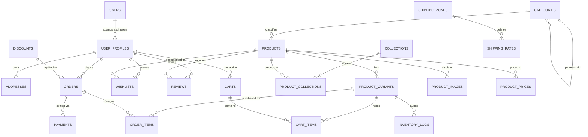

# Production International Winter Fashion & Lifestyle E-Commerce Platform
## Database Schema & Data Architecture Specification

**Document Version:** 1.0.0  
**Target Engine:** PostgreSQL 15+ (Supabase)  
**Security Model:** Comprehensive Row Level Security (RLS) & Role-Based Access Control (RBAC)

---

## 1. Entity Relationship Model (ERD)



---

## 2. PostgreSQL Extensions & Enum Types

```sql
-- Enable necessary extensions
CREATE EXTENSION IF NOT EXISTS "uuid-ossp";
CREATE EXTENSION IF NOT EXISTS "pgcrypto";

-- Custom Domain Enums
CREATE TYPE user_role AS ENUM ('customer', 'staff', 'admin', 'super_admin');
CREATE TYPE order_status AS ENUM ('pending', 'authorized', 'paid', 'processing', 'shipped', 'delivered', 'cancelled', 'refunded');
CREATE TYPE payment_status AS ENUM ('pending', 'authorized', 'captured', 'failed', 'refunded', 'partially_refunded');
CREATE TYPE fulfillment_status AS ENUM ('unfulfilled', 'partially_fulfilled', 'fulfilled', 'returned');
CREATE TYPE discount_type AS ENUM ('percentage', 'fixed_amount', 'free_shipping');
CREATE TYPE gender_category AS ENUM ('men', 'women', 'unisex', 'kids');
CREATE TYPE supported_currency AS ENUM ('USD', 'EUR', 'GBP', 'CAD');
CREATE TYPE fit_feedback AS ENUM ('runs_small', 'true_to_size', 'runs_large');
CREATE TYPE inventory_change_type AS ENUM ('sale', 'restock', 'return', 'adjustment', 'damage');
```

---

## 3. Relational Schema & Table Definitions

### 3.1 Identity & User Profiles

```sql
-- Links to Supabase auth.users
CREATE TABLE public.user_profiles (
    id UUID PRIMARY KEY REFERENCES auth.users(id) ON DELETE CASCADE,
    email TEXT NOT NULL UNIQUE,
    first_name TEXT,
    last_name TEXT,
    phone TEXT,
    role user_role NOT NULL DEFAULT 'customer',
    preferred_currency supported_currency NOT NULL DEFAULT 'USD',
    preferred_locale TEXT NOT NULL DEFAULT 'en-US',
    created_at TIMESTAMPTZ NOT NULL DEFAULT timezone('utc'::text, now()),
    updated_at TIMESTAMPTZ NOT NULL DEFAULT timezone('utc'::text, now())
);

CREATE INDEX idx_user_profiles_role ON public.user_profiles(role);
CREATE INDEX idx_user_profiles_email ON public.user_profiles(email);
```

### 3.2 Product Catalog & Hierarchy

```sql
-- Product Categories (Hierarchical with self-referencing parent_id)
CREATE TABLE public.categories (
    id UUID PRIMARY KEY DEFAULT uuid_generate_v4(),
    parent_id UUID REFERENCES public.categories(id) ON DELETE SET NULL,
    slug TEXT NOT NULL UNIQUE,
    name TEXT NOT NULL,
    description TEXT,
    image_url TEXT,
    display_order INTEGER NOT NULL DEFAULT 0,
    is_active BOOLEAN NOT NULL DEFAULT true,
    created_at TIMESTAMPTZ NOT NULL DEFAULT timezone('utc'::text, now()),
    updated_at TIMESTAMPTZ NOT NULL DEFAULT timezone('utc'::text, now())
);

CREATE INDEX idx_categories_parent ON public.categories(parent_id);
CREATE INDEX idx_categories_slug ON public.categories(slug);

-- Curated Collections (Seasonal drops, e.g. "Sub-Zero Expedition", "Alpine Cashmere")
CREATE TABLE public.collections (
    id UUID PRIMARY KEY DEFAULT uuid_generate_v4(),
    slug TEXT NOT NULL UNIQUE,
    title TEXT NOT NULL,
    subtitle TEXT,
    description TEXT,
    banner_image_url TEXT,
    start_date TIMESTAMPTZ,
    end_date TIMESTAMPTZ,
    is_featured BOOLEAN NOT NULL DEFAULT false,
    is_active BOOLEAN NOT NULL DEFAULT true,
    created_at TIMESTAMPTZ NOT NULL DEFAULT timezone('utc'::text, now()),
    updated_at TIMESTAMPTZ NOT NULL DEFAULT timezone('utc'::text, now())
);

CREATE INDEX idx_collections_slug ON public.collections(slug);

-- Base Products
CREATE TABLE public.products (
    id UUID PRIMARY KEY DEFAULT uuid_generate_v4(),
    category_id UUID NOT NULL REFERENCES public.categories(id) ON DELETE RESTRICT,
    title TEXT NOT NULL,
    slug TEXT NOT NULL UNIQUE,
    short_description TEXT,
    description TEXT NOT NULL, -- Rich Markdown or HTML
    gender gender_category NOT NULL DEFAULT 'unisex',
    base_price DECIMAL(10, 2) NOT NULL CHECK (base_price >= 0), -- Base reference price in USD
    
    -- Technical Winter Attributes (JSONB for flexibility and high performance)
    -- Structure: {"min_temp_c": -30, "max_temp_c": -10, "rating_label": "Sub-Zero Alpine"}
    temperature_rating JSONB DEFAULT '{}'::jsonb,
    
    -- Structure: {"hydrostatic_head_mm": 20000, "dwr_finish": true, "breathability_g_m2": 15000}
    weather_protection JSONB DEFAULT '{}'::jsonb,
    
    -- Structure: {"type": "Goose Down", "fill_power": 850, "down_to_feather": "90/10", "weight_gsm": 450}
    insulation_specs JSONB DEFAULT '{}'::jsonb,
    
    materials TEXT[], -- Array e.g. ["100% Recycled Polyamide", "Merino Wool", "Gore-Tex"]
    care_instructions TEXT[],
    sustainability_certifications TEXT[], -- e.g. ["RDS Certified", "OEKO-TEX Standard 100"]
    
    is_featured BOOLEAN NOT NULL DEFAULT false,
    is_active BOOLEAN NOT NULL DEFAULT true,
    meta_title TEXT,
    meta_description TEXT,
    created_at TIMESTAMPTZ NOT NULL DEFAULT timezone('utc'::text, now()),
    updated_at TIMESTAMPTZ NOT NULL DEFAULT timezone('utc'::text, now())
);

CREATE INDEX idx_products_category ON public.products(category_id);
CREATE INDEX idx_products_slug ON public.products(slug);
CREATE INDEX idx_products_active ON public.products(is_active);
CREATE INDEX idx_products_temp_rating ON public.products USING gin (temperature_rating);

-- Product-to-Collection Many-to-Many Join
CREATE TABLE public.product_collections (
    product_id UUID NOT NULL REFERENCES public.products(id) ON DELETE CASCADE,
    collection_id UUID NOT NULL REFERENCES public.collections(id) ON DELETE CASCADE,
    display_order INTEGER NOT NULL DEFAULT 0,
    PRIMARY KEY (product_id, collection_id)
);
```

### 3.3 Multi-Currency Pricing & Variants

```sql
-- Multi-Currency Price Matrix (Overrides base conversion with market-tailored prices)
CREATE TABLE public.product_prices (
    id UUID PRIMARY KEY DEFAULT uuid_generate_v4(),
    product_id UUID NOT NULL REFERENCES public.products(id) ON DELETE CASCADE,
    currency supported_currency NOT NULL,
    amount DECIMAL(10, 2) NOT NULL CHECK (amount >= 0),
    compare_at_amount DECIMAL(10, 2) CHECK (compare_at_amount >= amount),
    created_at TIMESTAMPTZ NOT NULL DEFAULT timezone('utc'::text, now()),
    updated_at TIMESTAMPTZ NOT NULL DEFAULT timezone('utc'::text, now()),
    UNIQUE(product_id, currency)
);

CREATE INDEX idx_product_prices_lookup ON public.product_prices(product_id, currency);

-- Product Variants (Size, Color, SKU, Stock)
CREATE TABLE public.product_variants (
    id UUID PRIMARY KEY DEFAULT uuid_generate_v4(),
    product_id UUID NOT NULL REFERENCES public.products(id) ON DELETE CASCADE,
    sku TEXT NOT NULL UNIQUE,
    size TEXT NOT NULL, -- 'XS', 'S', 'M', 'L', 'XL', 'XXL', or 'One Size'
    color_name TEXT NOT NULL, -- e.g. 'Glacial Blue', 'Nordic Obsidian', 'Highland Pine'
    color_hex TEXT NOT NULL, -- e.g. '#1E293B'
    stock_quantity INTEGER NOT NULL DEFAULT 0 CHECK (stock_quantity >= 0),
    safety_stock INTEGER NOT NULL DEFAULT 2, -- Threshold before "Low Stock" warning
    weight_grams INTEGER NOT NULL DEFAULT 500, -- Used for dynamic shipping weight calculation
    is_active BOOLEAN NOT NULL DEFAULT true,
    created_at TIMESTAMPTZ NOT NULL DEFAULT timezone('utc'::text, now()),
    updated_at TIMESTAMPTZ NOT NULL DEFAULT timezone('utc'::text, now())
);

CREATE INDEX idx_product_variants_product ON public.product_variants(product_id);
CREATE INDEX idx_product_variants_sku ON public.product_variants(sku);

-- Product Media Gallery
CREATE TABLE public.product_images (
    id UUID PRIMARY KEY DEFAULT uuid_generate_v4(),
    product_id UUID NOT NULL REFERENCES public.products(id) ON DELETE CASCADE,
    variant_id UUID REFERENCES public.product_variants(id) ON DELETE SET NULL, -- Optional link to specific colorway
    image_url TEXT NOT NULL,
    alt_text TEXT,
    display_order INTEGER NOT NULL DEFAULT 0,
    is_primary BOOLEAN NOT NULL DEFAULT false,
    created_at TIMESTAMPTZ NOT NULL DEFAULT timezone('utc'::text, now())
);

CREATE INDEX idx_product_images_product ON public.product_images(product_id);
```

### 3.4 Inventory Audit Logs

```sql
CREATE TABLE public.inventory_logs (
    id UUID PRIMARY KEY DEFAULT uuid_generate_v4(),
    variant_id UUID NOT NULL REFERENCES public.product_variants(id) ON DELETE CASCADE,
    change_type inventory_change_type NOT NULL,
    quantity_delta INTEGER NOT NULL,
    previous_quantity INTEGER NOT NULL,
    new_quantity INTEGER NOT NULL,
    reference_id TEXT, -- e.g., Order Number or Restock PO Number
    reason TEXT,
    created_by UUID REFERENCES auth.users(id) ON DELETE SET NULL,
    created_at TIMESTAMPTZ NOT NULL DEFAULT timezone('utc'::text, now())
);

CREATE INDEX idx_inventory_logs_variant ON public.inventory_logs(variant_id);
```

### 3.5 Carts & Guest Persistence

```sql
-- Carts support both authenticated users and anonymous guest sessions
CREATE TABLE public.carts (
    id UUID PRIMARY KEY DEFAULT uuid_generate_v4(),
    user_id UUID REFERENCES auth.users(id) ON DELETE CASCADE,
    session_token TEXT NOT NULL UNIQUE, -- Encrypted cookie identifier for guests
    currency supported_currency NOT NULL DEFAULT 'USD',
    expires_at TIMESTAMPTZ NOT NULL DEFAULT (now() + INTERVAL '30 days'),
    created_at TIMESTAMPTZ NOT NULL DEFAULT timezone('utc'::text, now()),
    updated_at TIMESTAMPTZ NOT NULL DEFAULT timezone('utc'::text, now())
);

CREATE INDEX idx_carts_session ON public.carts(session_token);
CREATE INDEX idx_carts_user ON public.carts(user_id);

CREATE TABLE public.cart_items (
    id UUID PRIMARY KEY DEFAULT uuid_generate_v4(),
    cart_id UUID NOT NULL REFERENCES public.carts(id) ON DELETE CASCADE,
    variant_id UUID NOT NULL REFERENCES public.product_variants(id) ON DELETE CASCADE,
    quantity INTEGER NOT NULL CHECK (quantity > 0),
    unit_price_at_addition DECIMAL(10, 2) NOT NULL,
    created_at TIMESTAMPTZ NOT NULL DEFAULT timezone('utc'::text, now()),
    updated_at TIMESTAMPTZ NOT NULL DEFAULT timezone('utc'::text, now()),
    UNIQUE(cart_id, variant_id)
);

CREATE INDEX idx_cart_items_cart ON public.cart_items(cart_id);
```

### 3.6 Addresses & Customer Data

```sql
CREATE TABLE public.addresses (
    id UUID PRIMARY KEY DEFAULT uuid_generate_v4(),
    user_id UUID NOT NULL REFERENCES auth.users(id) ON DELETE CASCADE,
    is_default BOOLEAN NOT NULL DEFAULT false,
    first_name TEXT NOT NULL,
    last_name TEXT NOT NULL,
    company TEXT,
    address_line1 TEXT NOT NULL,
    address_line2 TEXT,
    city TEXT NOT NULL,
    state_province TEXT NOT NULL,
    postal_code TEXT NOT NULL,
    country_code VARCHAR(2) NOT NULL, -- ISO-2 (US, GB, CA, DE, FR, NL)
    phone TEXT NOT NULL,
    created_at TIMESTAMPTZ NOT NULL DEFAULT timezone('utc'::text, now()),
    updated_at TIMESTAMPTZ NOT NULL DEFAULT timezone('utc'::text, now())
);

CREATE INDEX idx_addresses_user ON public.addresses(user_id);
```

### 3.7 Orders, Line Items & Payments

```sql
-- Orders Master Table
CREATE TABLE public.orders (
    id UUID PRIMARY KEY DEFAULT uuid_generate_v4(),
    order_number TEXT NOT NULL UNIQUE, -- e.g. "WIN-2026-10042"
    user_id UUID REFERENCES auth.users(id) ON DELETE SET NULL, -- Nullable for guest checkouts
    guest_email TEXT,
    status order_status NOT NULL DEFAULT 'pending',
    payment_status payment_status NOT NULL DEFAULT 'pending',
    fulfillment_status fulfillment_status NOT NULL DEFAULT 'unfulfilled',
    currency supported_currency NOT NULL DEFAULT 'USD',
    
    -- Financial Totals (Stored in charged currency)
    subtotal_amount DECIMAL(10, 2) NOT NULL CHECK (subtotal_amount >= 0),
    shipping_amount DECIMAL(10, 2) NOT NULL DEFAULT 0.00 CHECK (shipping_amount >= 0),
    tax_amount DECIMAL(10, 2) NOT NULL DEFAULT 0.00 CHECK (tax_amount >= 0),
    discount_amount DECIMAL(10, 2) NOT NULL DEFAULT 0.00 CHECK (discount_amount >= 0),
    total_amount DECIMAL(10, 2) NOT NULL CHECK (total_amount >= 0),
    
    -- Address Snapshots (Immutable at time of purchase)
    shipping_address JSONB NOT NULL,
    billing_address JSONB NOT NULL,
    
    -- Logistics & Fulfillment Details
    shipping_carrier TEXT, -- 'DHL Express', 'FedEx', 'UPS', 'Royal Mail'
    tracking_number TEXT,
    tracking_url TEXT,
    dispatched_at TIMESTAMPTZ,
    delivered_at TIMESTAMPTZ,
    customer_notes TEXT,
    
    created_at TIMESTAMPTZ NOT NULL DEFAULT timezone('utc'::text, now()),
    updated_at TIMESTAMPTZ NOT NULL DEFAULT timezone('utc'::text, now())
);

CREATE INDEX idx_orders_user ON public.orders(user_id);
CREATE INDEX idx_orders_order_number ON public.orders(order_number);
CREATE INDEX idx_orders_status ON public.orders(status);
CREATE INDEX idx_orders_created_at ON public.orders(created_at DESC);

-- Order Items (Snapshot of purchased products)
CREATE TABLE public.order_items (
    id UUID PRIMARY KEY DEFAULT uuid_generate_v4(),
    order_id UUID NOT NULL REFERENCES public.orders(id) ON DELETE CASCADE,
    product_id UUID REFERENCES public.products(id) ON DELETE SET NULL,
    variant_id UUID REFERENCES public.product_variants(id) ON DELETE SET NULL,
    product_title TEXT NOT NULL,
    variant_sku TEXT NOT NULL,
    size TEXT NOT NULL,
    color_name TEXT NOT NULL,
    quantity INTEGER NOT NULL CHECK (quantity > 0),
    unit_price DECIMAL(10, 2) NOT NULL CHECK (unit_price >= 0),
    total_price DECIMAL(10, 2) NOT NULL CHECK (total_price >= 0),
    created_at TIMESTAMPTZ NOT NULL DEFAULT timezone('utc'::text, now())
);

CREATE INDEX idx_order_items_order ON public.order_items(order_id);

-- Payment Ledger & Stripe Transactions
CREATE TABLE public.payments (
    id UUID PRIMARY KEY DEFAULT uuid_generate_v4(),
    order_id UUID NOT NULL REFERENCES public.orders(id) ON DELETE CASCADE,
    payment_gateway TEXT NOT NULL DEFAULT 'stripe',
    stripe_payment_intent_id TEXT NOT NULL UNIQUE,
    stripe_charge_id TEXT,
    amount DECIMAL(10, 2) NOT NULL,
    currency supported_currency NOT NULL,
    status payment_status NOT NULL DEFAULT 'pending',
    payment_method_type TEXT, -- 'card', 'apple_pay', 'google_pay', 'klarna', 'ideal'
    payment_method_last4 VARCHAR(4),
    error_message TEXT,
    created_at TIMESTAMPTZ NOT NULL DEFAULT timezone('utc'::text, now())
);

CREATE INDEX idx_payments_order ON public.payments(order_id);
CREATE INDEX idx_payments_stripe_pi ON public.payments(stripe_payment_intent_id);

-- Stripe Webhook Idempotency Event Registry
CREATE TABLE public.stripe_events (
    id TEXT PRIMARY KEY, -- Stripe Event ID (e.g. evt_1N4...)
    event_type TEXT NOT NULL,
    payload JSONB NOT NULL,
    processed_at TIMESTAMPTZ NOT NULL DEFAULT timezone('utc'::text, now())
);
```

### 3.8 Marketing, Discounts & Reviews

```sql
-- Promotional Discount Engine
CREATE TABLE public.discounts (
    id UUID PRIMARY KEY DEFAULT uuid_generate_v4(),
    code TEXT NOT NULL UNIQUE,
    description TEXT,
    type discount_type NOT NULL DEFAULT 'percentage',
    value DECIMAL(10, 2) NOT NULL CHECK (value > 0), -- e.g. 20.00 for 20% or $20.00
    min_order_amount DECIMAL(10, 2) DEFAULT 0.00,
    max_discount_amount DECIMAL(10, 2), -- Cap for percentage discounts
    start_date TIMESTAMPTZ NOT NULL DEFAULT timezone('utc'::text, now()),
    end_date TIMESTAMPTZ,
    usage_limit INTEGER, -- Global max uses
    times_used INTEGER NOT NULL DEFAULT 0,
    is_active BOOLEAN NOT NULL DEFAULT true,
    created_at TIMESTAMPTZ NOT NULL DEFAULT timezone('utc'::text, now())
);

CREATE INDEX idx_discounts_code ON public.discounts(code);

-- Product Reviews with Verified Purchase Validation
CREATE TABLE public.reviews (
    id UUID PRIMARY KEY DEFAULT uuid_generate_v4(),
    product_id UUID NOT NULL REFERENCES public.products(id) ON DELETE CASCADE,
    user_id UUID NOT NULL REFERENCES auth.users(id) ON DELETE CASCADE,
    rating INTEGER NOT NULL CHECK (rating >= 1 AND rating <= 5),
    warmth_rating INTEGER CHECK (warmth_rating >= 1 AND warmth_rating <= 5),
    fit_feedback fit_feedback DEFAULT 'true_to_size',
    title TEXT,
    comment TEXT NOT NULL,
    is_verified_purchase BOOLEAN NOT NULL DEFAULT false,
    is_approved BOOLEAN NOT NULL DEFAULT true, -- Auto-approve or moderation flag
    created_at TIMESTAMPTZ NOT NULL DEFAULT timezone('utc'::text, now()),
    updated_at TIMESTAMPTZ NOT NULL DEFAULT timezone('utc'::text, now()),
    UNIQUE(product_id, user_id)
);

CREATE INDEX idx_reviews_product ON public.reviews(product_id);

-- Customer Wishlists
CREATE TABLE public.wishlists (
    user_id UUID NOT NULL REFERENCES auth.users(id) ON DELETE CASCADE,
    product_id UUID NOT NULL REFERENCES public.products(id) ON DELETE CASCADE,
    created_at TIMESTAMPTZ NOT NULL DEFAULT timezone('utc'::text, now()),
    PRIMARY KEY (user_id, product_id)
);
```

### 3.9 Shipping Zones & Rates

```sql
CREATE TABLE public.shipping_zones (
    id UUID PRIMARY KEY DEFAULT uuid_generate_v4(),
    name TEXT NOT NULL, -- e.g. "North America", "European Union", "United Kingdom"
    country_codes TEXT[] NOT NULL, -- e.g. ARRAY['US', 'CA']
    is_active BOOLEAN NOT NULL DEFAULT true
);

CREATE TABLE public.shipping_rates (
    id UUID PRIMARY KEY DEFAULT uuid_generate_v4(),
    zone_id UUID NOT NULL REFERENCES public.shipping_zones(id) ON DELETE CASCADE,
    title TEXT NOT NULL, -- e.g. "Standard Tracked Delivery (4-7 Days)"
    carrier TEXT NOT NULL, -- "FedEx", "DHL Express"
    currency supported_currency NOT NULL DEFAULT 'USD',
    base_rate DECIMAL(10, 2) NOT NULL CHECK (base_rate >= 0),
    free_shipping_threshold DECIMAL(10, 2), -- e.g. Free above $200
    estimated_days_min INTEGER NOT NULL DEFAULT 3,
    estimated_days_max INTEGER NOT NULL DEFAULT 7,
    is_active BOOLEAN NOT NULL DEFAULT true
);

CREATE INDEX idx_shipping_rates_zone ON public.shipping_rates(zone_id);
```

---

## 4. Database Functions, Triggers & Procedures

### 4.1 Automated Timestamp Synchronization
```sql
CREATE OR REPLACE FUNCTION public.handle_updated_at()
RETURNS TRIGGER AS $$
BEGIN
    NEW.updated_at = timezone('utc'::text, now());
    RETURN NEW;
END;
$$ LANGUAGE plpgsql;

-- Apply trigger to tables with updated_at
CREATE TRIGGER tr_user_profiles_updated BEFORE UPDATE ON public.user_profiles FOR EACH ROW EXECUTE FUNCTION public.handle_updated_at();
CREATE TRIGGER tr_products_updated BEFORE UPDATE ON public.products FOR EACH ROW EXECUTE FUNCTION public.handle_updated_at();
CREATE TRIGGER tr_product_variants_updated BEFORE UPDATE ON public.product_variants FOR EACH ROW EXECUTE FUNCTION public.handle_updated_at();
CREATE TRIGGER tr_categories_updated BEFORE UPDATE ON public.categories FOR EACH ROW EXECUTE FUNCTION public.handle_updated_at();
CREATE TRIGGER tr_carts_updated BEFORE UPDATE ON public.carts FOR EACH ROW EXECUTE FUNCTION public.handle_updated_at();
CREATE TRIGGER tr_orders_updated BEFORE UPDATE ON public.orders FOR EACH ROW EXECUTE FUNCTION public.handle_updated_at();
```

### 4.2 Sequence-Based Order Number Generator
```sql
CREATE SEQUENCE IF NOT EXISTS public.order_number_seq START WITH 10001;

CREATE OR REPLACE FUNCTION public.generate_order_number()
RETURNS TRIGGER AS $$
BEGIN
    IF NEW.order_number IS NULL OR NEW.order_number = '' THEN
        NEW.order_number = 'WIN-' || TO_CHAR(NOW(), 'YYYY') || '-' || NEXTVAL('public.order_number_seq')::TEXT;
    END IF;
    RETURN NEW;
END;
$$ LANGUAGE plpgsql;

CREATE TRIGGER tr_orders_order_number BEFORE INSERT ON public.orders FOR EACH ROW EXECUTE FUNCTION public.generate_order_number();
```

### 4.3 Atomic Inventory Reservation & Decrement Procedure
```sql
CREATE OR REPLACE FUNCTION public.atomic_deduct_inventory(
    p_order_id UUID
)
RETURNS VOID AS $$
DECLARE
    r RECORD;
BEGIN
    -- Iterate through order items with row lock to prevent race conditions
    FOR r IN 
        SELECT oi.variant_id, oi.quantity, pv.stock_quantity, pv.sku
        FROM public.order_items oi
        JOIN public.product_variants pv ON pv.id = oi.variant_id
        WHERE oi.order_id = p_order_id
        FOR UPDATE OF pv
    LOOP
        IF r.stock_quantity < r.quantity THEN
            RAISE EXCEPTION 'Insufficient stock for SKU %: requested %, available %', r.sku, r.quantity, r.stock_quantity;
        END IF;

        -- Decrement stock
        UPDATE public.product_variants
        SET stock_quantity = stock_quantity - r.quantity
        WHERE id = r.variant_id;

        -- Record inventory audit log
        INSERT INTO public.inventory_logs (
            variant_id,
            change_type,
            quantity_delta,
            previous_quantity,
            new_quantity,
            reference_id,
            reason
        ) VALUES (
            r.variant_id,
            'sale',
            -r.quantity,
            r.stock_quantity,
            r.stock_quantity - r.quantity,
            p_order_id::TEXT,
            'Order Checkout Settlement'
        );
    END LOOP;
END;
$$ LANGUAGE plpgsql SECURITY DEFINER;
```

---

## 5. Comprehensive Row Level Security (RLS) Policies

All tables have RLS enabled by default:

```sql
ALTER TABLE public.user_profiles ENABLE ROW LEVEL SECURITY;
ALTER TABLE public.categories ENABLE ROW LEVEL SECURITY;
ALTER TABLE public.collections ENABLE ROW LEVEL SECURITY;
ALTER TABLE public.products ENABLE ROW LEVEL SECURITY;
ALTER TABLE public.product_collections ENABLE ROW LEVEL SECURITY;
ALTER TABLE public.product_variants ENABLE ROW LEVEL SECURITY;
ALTER TABLE public.product_images ENABLE ROW LEVEL SECURITY;
ALTER TABLE public.product_prices ENABLE ROW LEVEL SECURITY;
ALTER TABLE public.inventory_logs ENABLE ROW LEVEL SECURITY;
ALTER TABLE public.carts ENABLE ROW LEVEL SECURITY;
ALTER TABLE public.cart_items ENABLE ROW LEVEL SECURITY;
ALTER TABLE public.addresses ENABLE ROW LEVEL SECURITY;
ALTER TABLE public.orders ENABLE ROW LEVEL SECURITY;
ALTER TABLE public.order_items ENABLE ROW LEVEL SECURITY;
ALTER TABLE public.payments ENABLE ROW LEVEL SECURITY;
ALTER TABLE public.discounts ENABLE ROW LEVEL SECURITY;
ALTER TABLE public.reviews ENABLE ROW LEVEL SECURITY;
ALTER TABLE public.wishlists ENABLE ROW LEVEL SECURITY;
ALTER TABLE public.shipping_zones ENABLE ROW LEVEL SECURITY;
ALTER TABLE public.shipping_rates ENABLE ROW LEVEL SECURITY;
ALTER TABLE public.stripe_events ENABLE ROW LEVEL SECURITY;
```

### 5.1 Helper Function: Role Inspection
```sql
CREATE OR REPLACE FUNCTION public.is_admin()
RETURNS BOOLEAN AS $$
BEGIN
    RETURN EXISTS (
        SELECT 1 FROM public.user_profiles
        WHERE id = auth.uid()
        AND role IN ('admin', 'super_admin')
    );
END;
$$ LANGUAGE plpgsql SECURITY DEFINER;

CREATE OR REPLACE FUNCTION public.is_staff()
RETURNS BOOLEAN AS $$
BEGIN
    RETURN EXISTS (
        SELECT 1 FROM public.user_profiles
        WHERE id = auth.uid()
        AND role IN ('staff', 'admin', 'super_admin')
    );
END;
$$ LANGUAGE plpgsql SECURITY DEFINER;
```

### 5.2 RLS Rules Summary

| Table | Public Access | Authenticated Customer Access | Staff / Admin Access |
| :--- | :--- | :--- | :--- |
| **`categories`, `collections`** | `SELECT` (active = true) | `SELECT` (active = true) | Full CRUD (Admins) |
| **`products`, `product_variants`, `product_images`, `product_prices`** | `SELECT` (active = true) | `SELECT` (active = true) | Full CRUD (Admins) |
| **`user_profiles`** | None | `SELECT`, `UPDATE` (own id only) | `SELECT` all, `UPDATE` roles (Admins) |
| **`addresses`** | None | Full CRUD (own records only) | `SELECT` all (for order fulfillment) |
| **`carts`, `cart_items`** | `SELECT`, `INSERT`, `UPDATE` matching session token | Full CRUD (own user_id or session token) | Read-only analytics |
| **`orders`, `order_items`** | None | `SELECT` (own user_id) | Full CRUD (Staff / Admins) |
| **`payments`** | None | `SELECT` (linked to own order) | Read-only (Staff), Refund trigger (Admin) |
| **`reviews`** | `SELECT` (approved = true) | `INSERT`, `UPDATE` (own review) | Full CRUD / Moderation |
| **`wishlists`** | None | Full CRUD (own user_id) | Read-only |
| **`inventory_logs`** | None | None | `SELECT` (Staff), `INSERT` (Admin) |
| **`stripe_events`** | None (Webhook service role only) | None | Read-only (Admin debugging) |
